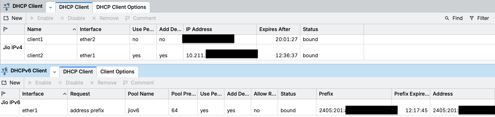

# Demystifying True Layer-2 Bridge Mode on JioFiber ONTs (JCO4032) with MikroTik RouterOS v7

---

If you have spent time in home-lab and FTTH networking discussions, you have seen the recurring consensus: **"True bridge mode on JioFiber is impossible."**

People have tried asking customer support (who either don't understand or state it is disabled on consumer plans), tweaking hidden Web UI toggles, selecting "Bridge" in TR-069 WAN profiles, or configuring secondary routers in DMZ. The result is always the same: either the ONT locks up, return packets vanish into thin air, the downstream router gets into an endless DHCP battle with the ONT’s internal `dnsmasq`, or IPv6 silently dies.

We reversed the firmware, examined the EcoNet EN7528 / MediaTek MT7530 hardware switch registers, and traced the packet path through the Linux kernel. 

**True, transparent Layer-2 bridge mode on the JioFiber Sercomm JCO4032 ONT is 100% possible**, with:
- **Full IPv4 and native IPv6 dual-stack** (delegated `/64` prefix directly to your own router).
- **Single-cable operation** with simultaneous, in-band ONT management (reach `http://192.168.30.1` over the same WAN cable).
- **Zero DHCP races on boot** (no rogue `192.168.29.x` IP offered to your router).
- **Persistent surviving power cycles and reboots**, with zero binary modifications to vendor squashfs images.
- **No external black-box tool required**: every step below is executed strictly using standard Linux network commands (`brctl`, `smuxctl`, `ifconfig`, `ebtables`, `sysctl`) and native MikroTik RouterOS v7 CLI commands.

Here is the exhaustive, deep-dive engineering guide on how the Jio GPON platform actually works, why standard bridging attempts fail, and the exact manual commands to configure your ONT and MikroTik router.

---

## 1. Anatomy of the Problem: Why Jio "Bridge Mode" Usually Fails

Before touching a terminal, you must understand the five hardware and kernel traps built into the JCO4032 (and sibling EcoNet EN7528 ONTs):

### Trap 1: The "Half-Bridge" Firmware Illusion
When you examine `/pfrm2.0/bin/wan_start_TF1.sh` and vendor scripts like `vlanUpdateBdg.sh`, the stock firmware actually has code to create a bridge interface:
```sh
smuxctl add ipoe pon nas0_1 3 1015 0 0
brctl addif bdgpublic nas0_1
```
However, the vendor stops halfway:
1. It **never attaches LAN Port 4** to `bdgpublic`.
2. It leaves the stock routed WAN (`nas0_0` on `bdg1`) active. `nas0_0` stays bound to the PON and **swallows downstream unicast packets**.
3. It sets `nas0_1`'s MAC to the ONT’s real WAN MAC (`cat /var/wanMac`). When your downstream router clones that same MAC, the Linux kernel bridge (`br_input.c`) detects incoming frames matching a local bridge port, marks them `is_local = 1`, and passes them to the ONT's local CPU instead of forwarding them down LAN Port 4!

### Trap 2: The Two-Sided DHCP Race
By default, the ONT switch initialization script `/pfrm2.0/bin/vlanUpdate.sh` configures switch VLAN 1 with `fwdMap = "1,2,3,4"` at second zero. The ONT’s internal `dnsmasq` listens on `0.0.0.0:67`. When both devices boot up, the ONT answers your router's DHCPDISCOVER with a `192.168.29.x` lease before the carrier's BNG can answer on the WAN.

### Trap 3: The IPv6 Black Hole (`bridge-nf-call-ip6tables`)
On stock Jio firmware, the kernel has `/proc/sys/net/bridge/bridge-nf-call-ip6tables` set to `1`. Every bridged IPv6 frame is diverted to the kernel's `ip6tables` netfilter hook. But the vendor's `ip6tables` userspace binary is broken (missing `libxt_standard.so` libraries). Because netfilter cannot process the frame, **every single bridged IPv6 frame is silently dropped in the kernel**.

### Trap 4: The Phantom Router Advertisement
The carrier network emits two Router Advertisements (RAs): one from the legitimate BNG and a "phantom" RA from an intermediate node. Furthermore, both advertise an invalid link MTU of `9202`. If your router blindly accepts RAs, it installs two default routes, flapping between them and black-holing 50% of IPv6 outbound traffic.

### Trap 5: Embedded Spyware (Allot HomeSecure / CyberIoT)
The ONT firmware ships with a carrier-side agent (`/pfrm2.0/bin/cyberiot_init.sh` and `/usr/bin/nget2`) triggered by `/tmp/AllotEnable`. If enabled by the ACS, it attempts to scan and enumerate LAN devices. We can neutralize it cleanly in RAM without risking NAND corruption.

---

## 2. Prerequisites & Architecture

```
                       ┌────────────────────────────────────────────────────────┐
                       │                     JioFiber ONT                       │
                       │               Sercomm JCO4032 (EN7528)                 │
                       │                                                        │
[Optical Fiber] ───────┼─► PON (VLAN 1015)                                      │
                       │     │                                                  │
                       │     ├── nas0_0 (TORN DOWN & REMOVED)                   │
                       │     │                                                  │
                       │     └── nas0_1 (Dummy MAC: 02:00:00:00:00:02)          │
                       │           │                                            │
                       │       [bdgpublic] (Dummy MAC: 02:00:00:00:00:01)       │
                       │           │        (Static IP: 192.168.30.1/24)        │
                       │           │                                            │
                       │     LAN Port 4 (MT7530 PVID 1015, Untagged Egress)     │
                       └───────────┼────────────────────────────────────────────┘
                                   │
                           [Ethernet Patch Cable]
                                   │
                       ┌───────────┴────────────────────────────────────────────┐
                       │              Downstream Core Router                    │
                       │               MikroTik RouterOS v7                     │
                       │                                                        │
                       │  ether1 (Cloned WAN MAC: <ONT_WAN_MAC>)                │
                       │   ├── DHCP Client (IPv4: RFC 1918 carrier CGNAT IP)    │
                       │   ├── DHCPv6 Client (DUID: 0x00030001<ONT_WAN_MAC>)    │
                       │   │    └── Receives delegated /64 prefix to LAN        │
                       │   └── Static IP (192.168.30.2/24 for in-band mgmt)     │
                       └────────────────────────────────────────────────────────┘
```

1. **Target ONT**: Sercomm JCO4032 running firmware `SRCMTF1_JCO4032_R2.59.1` (similar EcoNet EN7528 / MT7530 boards share identical register architectures).
2. **Core Router**: MikroTik running RouterOS v7.
3. **Carrier Details**: Reliance JioFiber GPON, **VLAN 1015**, **IPoE** (DHCP, not PPPoE).
4. **Access Requirement**: Root shell access on the ONT (obtained via standard community tools like `JFxploit` to start `telnetd`/`dropbear`).

---

## 3. Step-by-Step ONT Configuration (By Hand)

> [!IMPORTANT]
> **Physical connection requirement:** Plug your computer into **LAN Ports 1, 2, or 3** (or connect via the ONT's default Wi-Fi).
> **Do NOT run these commands while plugged into LAN Port 4.**
> When Port 4 is converted to bridge mode in Step 3.4, its connection to the stock management bridge is cut. If you run these steps through Port 4, your shell terminates mid-configuration and leaves the bridge incomplete.

Log into your ONT via Telnet/SSH as `root` (default LAN address `192.168.29.1`).
### Step 3.1: Read and Record Your ONT's Real WAN MAC
Run this command and save the output. Throughout this guide, replace `AA:BB:CC:DD:EE:FF` with this exact value:

```sh
cat /var/wanMac
# Example output: aa:bb:cc:dd:ee:ff
```

---

### Step 3.2: Eliminate the Boot-Time DHCP Race Permanently
We must stop LAN Port 4 from joining the stock bridge `bdg2` at second zero.
Edit `/flash/teamf1.cfg.ascii.network`:

```sh
# Backup the file first
cp /flash/teamf1.cfg.ascii.network /flash/teamf1.cfg.ascii.network.bak

# Change fwdMap and untagMap from "1,2,3,4" to "1,2,3"
sed -i 's/fwdMap="1,2,3,4"/fwdMap="1,2,3"/' /flash/teamf1.cfg.ascii.network
sed -i 's/untagMap="1,2,3,4"/untagMap="1,2,3"/' /flash/teamf1.cfg.ascii.network
```
*Why this works:* On boot, `swMgr` reads this configuration and programs the MT7530 hardware switch register. The VLAN 1 port matrix changes from `0b11110` (ports 1–4) to `0b1110` (ports 1–3 only). Port 4 is **physically isolated** from the ONT’s internal `dnsmasq` from the very first clock cycle of boot.

---

### Step 3.3: Tear Down the Stock Routed WAN
If `nas0_0` is running, your bridge will fail. Kill the stock DHCP client, strip the IP, and destroy the sub-interface:

```sh
killall -9 udhcpc
ifconfig bdg1 0.0.0.0 down
brctl delif bdg1 nas0_0 2>/dev/null
ifconfig nas0_0 down
/usr/bin/smuxctl rem nas0_0
```

---

### Step 3.4: Carve the Bridge WAN Interface & Program Switch PVID
Now create the bridged WAN interface on VLAN 1015 and enslave it to `bdgpublic`:

```sh
# 1. Create the carrier bridge WAN sub-interface on VLAN 1015
/pfrm2.0/bin/vlanUpdateBdg.sh ADD 1015

# 2. Program MT7530 switch ASIC to make Port 4 an untagged access port for VLAN 1015
/pfrm2.0/bin/vlanUpdate.sh ADD_BRIDGE_LAN 1015 4 0 4
```
*Under the hood:* `vlanUpdateBdg.sh` calls `smuxctl add ipoe pon nas0_1 3 1015 0 0` and adds `nas0_1` to `bdgpublic`. `ADD_BRIDGE_LAN` writes to switch register PVID 4 (`ethphxcmd vlan pvid 4 1015`), instructing the MediaTek hardware switch to tag untagged egress frames from your MikroTik with VLAN 1015 and strip VLAN 1015 tags before sending frames down Port 4 copper. **Your router receives clean, untagged Ethernet.**

---

### Step 3.5: The Dummy MAC Assignment (Kernel Unicast Fix)
This is where 99% of DIY bridge attempts fail. When your MikroTik clones the ONT's WAN MAC, you must assign **Locally Administered Addresses (LAAs)** to the ONT's local bridge interfaces:

```sh
# Assign dummy MAC to nas0_1
ifconfig nas0_1 down
ifconfig nas0_1 hw ether 02:00:00:00:00:02
ifconfig nas0_1 up

# Set STP forward delay to 0 (avoids 15-second black hole on linkup)
brctl setfd bdgpublic 0

# Assign dummy MAC to the bridge interface itself
ifconfig bdgpublic hw ether 02:00:00:00:00:01
ifconfig bdgpublic up

# Ensure Port 4 VLAN 1 subinterface is detached from bdg2
brctl delif bdg2 eth0.4.1 2>/dev/null
```
*Why this is mandatory:* If `nas0_1` or `bdgpublic` retains the real WAN MAC, the Linux kernel bridge (`br_input.c`) evaluates return unicast traffic (like your router's default gateway ARP replies or TCP SYN-ACKs) as `is_local = 1`. The ONT kernel consumes the packet locally and drops it, rather than forwarding it to Port 4. Giving the ONT bridge dummy MACs (`02:...`) forces the bridge to forward all carrier traffic to the MikroTik.

---

### Step 3.6: Unlock Native IPv6 Passthrough
Fix the vendor's broken netfilter sysctl:

```sh
echo 0 > /proc/sys/net/bridge/bridge-nf-call-ip6tables
```
*Why:* This prevents the kernel from directing bridged IPv6 Ethernet frames to the broken `ip6tables` engine. IPv6 frames will now pass transparently through the bridge.

---

### Step 3.7: Configure In-Band Single-Cable Management
You don't need a second cable plugged into LAN Ports 1–3 to manage the ONT. You can talk to it over the carrier cable:

```sh
# Assign in-band management IP
ifconfig bdgpublic 192.168.30.1 netmask 255.255.255.0

# Join xt_ifgroup Group 1 (Bypasses the INPUT DROP firewall)
LD_LIBRARY_PATH=/pfrm2.0/lib:/lib:/usr/lib /pfrm2.0/bin/ifgroup -j -d bdgpublic -G 1
```
*Why:* The ONT's firewall has an `INPUT DROP` default policy. Only interfaces enrolled in `xt_ifgroup` group 1 are permitted to accept TCP 80, 443, and 22. Without `ifgroup -G 1`, `192.168.30.1` will drop every packet.

---

### Step 3.8: Neutralize Allot HomeSecure / CyberIoT
Disarm the surveillance binary in memory:

```sh
# Remove the trigger flag
rm -f /tmp/AllotEnable

# Bind /dev/null over the initialization launchers
mount --bind /dev/null /pfrm2.0/etc/cyberInit
mount --bind /dev/null /pfrm2.0/bin/cyberiot_init.sh

# Mount an empty tmpfs over the package storage directory
mount -t tmpfs tmpfs /usr/local/opt/HomeSecure
```

---

## 4. MikroTik RouterOS v7 Configuration

Connect an Ethernet patch cable from **LAN Port 4 of the JCO4032** to **`ether1`** of your MikroTik.

Open RouterOS terminal. In the commands below, replace:
- `AA:BB:CC:DD:EE:FF` with your ONT's real WAN MAC (with colons).
- `aabbccddeeff` with your ONT's real WAN MAC in lowercase with no colons.

### Step 4.1: Clone the ONT WAN MAC Address

```routeros
/interface/ethernet/set [find name=ether1] mac-address=AA:BB:CC:DD:EE:FF
```

---

### Step 4.2: IPv4 DHCP Client (Option 60 & 61)
Jio's BNG strictly enforces DHCP Option 60 (`vendor-class-identifier`) matching the ASCII representation of the ONT's WAN MAC, and Option 61 (`client-identifier`) matching the binary MAC with hardware type `0x01`.

RouterOS has a built-in default option named `clientid` for Option 61 (which automatically formats `0x01` + `ether1`'s MAC). You only need to define Option 60:

```routeros
# Define DHCP Option 60 (Jio carrier vendor class: 0x12 length prefix + ASCII MAC)
# Replace AA:BB:CC:DD:EE:FF with your ONT's real uppercase WAN MAC
/ip/dhcp-client/option/add code=60 name=jio-carrier-opt60 value="0x12'AA:BB:CC:DD:EE:FF'"

# Configure IPv4 DHCP Client on raw ether1 (NO VLAN tagging - egress is untagged)
# Note: 'clientid' is the native RouterOS built-in option that supplies Option 61
/ip/dhcp-client/add interface=ether1 name="jio-v4" \
    dhcp-options=clientid,jio-carrier-opt60,hostname \
    add-default-route=yes default-route-distance=1 \
    use-peer-dns=yes use-peer-ntp=yes \
    comment="JioFiber Native Bridge WAN"
```
*Check:* Run `/ip/dhcp-client/print`. Within 2–5 seconds, `status=bound` will appear, and you will receive a dynamic carrier IP in the carrier's RFC 1918 range.

---

### Step 4.3: IPv6 Native Dual-Stack (DHCPv6-PD & Custom DUID)
Jio binds IPv6 prefix delegation to the **ONT's DUID-LL** (Type 3: `00:03:00:01` + ONT MAC).

```routeros
# 1. Block the Phantom RA & MTU 9202 Syslog Flood
/ipv6/firewall/raw/add chain=prerouting in-interface=ether1 protocol=icmpv6 \
    icmp-options=134 action=drop comment="Drop phantom carrier RA"

# 2. Configure IPv6 Settings: Ignore RAs (We route via DHCPv6)
/ipv6/settings/set accept-router-advertisements=no

# 3. Create DHCPv6 Client requesting both Address and Prefix Delegation
# Note: custom-duid is 0x00030001 followed by 12 hex digits of ONT MAC
/ipv6/dhcp-client/add interface=ether1 pool-name=jiov6 pool-prefix-length=64 \
    request=address,prefix add-default-route=yes default-route-distance=1 \
    use-interface-duid=no custom-duid=0x00030001aabbccddeeff \
    rapid-commit=yes comment="JioFiber IPv6 Dual-Stack"

# 4. Assign IPv6 address from the delegated pool to your LAN Bridge
/ipv6/address/add from-pool=jiov6 interface=bridge comment="LAN IPv6 via Jio"

# 5. Enable IPv6 Router Advertisements on LAN
/ipv6/nd/set [find default=yes] interface=bridge advertise-dns=yes managed-address-configuration=no other-configuration=no
```
*Check:* Run `/ipv6/dhcp-client/print`. It will bind immediately, creating a dynamic pool `/ipv6/pool/print` named `jiov6` holding your delegated `/64` prefix. Your LAN devices will configure public IPv6 addresses via SLAAC!

---

### Step 4.4: In-Band ONT Management from LAN
To access the ONT's status page (`192.168.30.1`) directly from your desktop or phone without changing cables:

```routeros
# Add static IP on the WAN interface for the management subnet
/ip/address/add address=192.168.30.2/24 interface=ether1 comment="Jio ONT in-band management"

# Add static permanent ARP entry for the ONT bridge dummy MAC
/ip/arp/add address=192.168.30.1 interface=ether1 mac-address=02:00:00:00:00:01 comment="ONT in-band bridge MAC"
```
Now, simply open `http://192.168.30.1` in your browser from any PC on your home LAN. Your MikroTik routes directly to the ONT over the single WAN Ethernet cable.

> [!TIP]
> **Management Fallback:** If `192.168.30.1` ever stops responding (due to a firewall typo or rule flush), you are not locked out. Plug an Ethernet cable into **LAN Ports 1, 2, or 3** with a manual IP (e.g. `192.168.29.10/24`) to regain access to the ONT's stock management plane on `192.168.29.1`.

---

### Step 4.5: Immediate IPv6 Resolicit Script (State-Latched Event Hook)
When the ONT boots up, IPv4 often binds before the optical GPON link transitions to O5 (Operation State). Under RFC 8415 rules, a DHCPv6 client that receives no reply on its initial Solicit applies exponential backoff: 1s, 2s, 4s, 8s... up to `MAX_SOL_TIMEOUT` (120s), adding a ~134-second delay before IPv6 binds.

To eliminate this delay without running CPU-wasting periodic schedulers, add this event-driven lease script to the IPv4 DHCP client. It uses a global state latch (`:global jioV6Solicited`) to ensure it executes **strictly once per link-up** and never fires on regular DHCPv4 T1 renewal events:

```routeros
# Formatted for readability:
:global jioV6Solicited;
:if ($bound = 1) do={
  :if ($jioV6Solicited != true) do={
    :if ([:len [/ipv6/dhcp-client/find interface=ether1 status=bound]] = 0) do={
      :set jioV6Solicited true;
      /ipv6/dhcp-client renew [find interface=ether1];
      :log info "Jio DHCPv4 bound: triggered immediate DHCPv6 re-solicitation";
    } else={
      :set jioV6Solicited true;
    };
  };
} else={
  :set jioV6Solicited false;
  :log warning "Jio DHCP unbound (routing unaffected)";
}
```

Paste it onto your MikroTik terminal as a single escaped command:

```routeros
/ip/dhcp-client/set [find interface=ether1] script=":global jioV6Solicited; :if (\$bound = 1) do={ :if (\$jioV6Solicited != true) do={ :if ([:len [/ipv6/dhcp-client/find interface=ether1 status=bound]] = 0) do={ :set jioV6Solicited true; /ipv6/dhcp-client renew [find interface=ether1]; :log info \"Jio DHCPv4 bound: triggered immediate DHCPv6 re-solicitation\"; } else={ :set jioV6Solicited true; }; }; } else={ :set jioV6Solicited false; :log warning \"Jio DHCP unbound (routing unaffected)\"; }"
```

*How it behaves:*
1. When IPv4 binds (`$bound = 1`) and IPv6 is still unbound, it fires one immediate renew and sets `jioV6Solicited = true`.
2. During ongoing operations, routine IPv4 lease renewals (T1) see `jioV6Solicited == true` and take **zero action** (0 wakeups/day in steady state).
3. If the link goes down (`$bound = 0`), the script automatically resets `jioV6Solicited = false`, re-arming the hook for the next link-up.

---

## 5. Making Bridge Mode Persistent Across ONT Reboots

> [!CAUTION]
> **Root Access Persistence Warning:**
> On stock firmware, root passwords and temporary Telnet daemons reset on every reboot (`rcS:304` restores `/usr/etc/passwd`).
> If you rely on custom Dropbear or password restoration scripts to maintain root access, **ensure your Dropbear launch and `/etc/passwd` restoration lines are included in Step 8 of `voipInit` before rebooting**.
> Because `/flash2/` persists across factory resets, writing a non-functional `voipInit` and rebooting without an active SSH/Telnet server will result in a permanent lockout that the physical pinhole reset button cannot clear.

On embedded ONTs running UBIFS on NAND flash, `/flash2/` is writable and survives reboots. The vendor early-boot hook `/flash2/pfrm2.0/etc/voipInit` is executed by `platformInit3:159` at uptime **~110 seconds**.

Save the entire manual sequence into `/flash2/pfrm2.0/etc/voipInit`:

```sh
cat << 'EOF' > /flash2/pfrm2.0/etc/voipInit
#!/bin/sh
# Early Bridge & Security Initialization Hook

# 1. Disarm Allot Spyware in RAM
rm -f /tmp/AllotEnable
mount --bind /dev/null /pfrm2.0/etc/cyberInit
mount --bind /dev/null /pfrm2.0/bin/cyberiot_init.sh
mount -t tmpfs tmpfs /usr/local/opt/HomeSecure

# 2. Wait up to 60s for GPON physical link
for i in $(seq 1 60); do
    [ -d /sys/class/net/nas0_0 ] && break
    sleep 1
done

# 3. Kill routed WAN
killall -9 udhcpc 2>/dev/null
ifconfig bdg1 0.0.0.0 down
brctl delif bdg1 nas0_0 2>/dev/null
ifconfig nas0_0 down
/usr/bin/smuxctl rem nas0_0 2>/dev/null

# 4. Bring up Bridge on VLAN 1015
/pfrm2.0/bin/vlanUpdateBdg.sh ADD 1015
/pfrm2.0/bin/vlanUpdate.sh ADD_BRIDGE_LAN 1015 4 0 4

# 5. Apply Dummy MACs & Zero Forward Delay
ifconfig nas0_1 down
ifconfig nas0_1 hw ether 02:00:00:00:00:02
ifconfig nas0_1 up

brctl setfd bdgpublic 0
ifconfig bdgpublic hw ether 02:00:00:00:00:01
ifconfig bdgpublic up
brctl delif bdg2 eth0.4.1 2>/dev/null

# 6. Enable Bridged IPv6 Passthrough
echo 0 > /proc/sys/net/bridge/bridge-nf-call-ip6tables

# 7. Configure In-Band Management Subnet
ifconfig bdgpublic 192.168.30.1 netmask 255.255.255.0
LD_LIBRARY_PATH=/pfrm2.0/lib:/lib:/usr/lib /pfrm2.0/bin/ifgroup -j -d bdgpublic -G 1

# 8. (Optional) Start your own Dropbear or SSH server here if needed.
# Setting up and maintaining persistent SSH access is the operator's responsibility.

exit 0
EOF

chmod 755 /flash2/pfrm2.0/etc/voipInit
```

---

## 6. Verification Checklist

Once configured, verify every layer of the stack:

### On the ONT:
```sh
# Verify bridge membership:
brctl show bdgpublic
# Expected:
# bridge name    bridge id            STP enabled    interfaces
# bdgpublic      8000.020000000001    no             nas0_1
#                                                    eth0.4.1015

# Verify switch port 4 PVID:
/userfs/bin/ethphxcmd vlan disp 2>&1 | grep -i pvid
# Expected: PVID for port 4 must be 1015 (e4:1015)

# Verify FDB table (your MikroTik MAC must show 'is local? = no'):
brctl showmacs bdgpublic

# Verify optical receiver levels:
cat /proc/pon_phy/DDMI_check_8472
```

### On the MikroTik:


```routeros
# Check IPv4 lease:
/ip/dhcp-client/print detail
# Expected: status=bound, address in carrier private range

# Check IPv6 lease:
/ipv6/dhcp-client/print detail
# Expected: status=bound, prefix=2405:...::/64

# Test end-to-end ping over IPv4:
/ping 1.1.1.1 count=5

# Test end-to-end ping over native IPv6:
/ping 2606:4700:4700::1111 count=5

# Test in-band ONT access over the carrier cable:
/ping 192.168.30.1 count=3
```

---

## 7. Diagnostic Troubleshooting Guide

| Symptom | Underlying Root Cause | Exact Remedy |
|---|---|---|
| **DHCP client binds, but gateway cannot be pinged; ARP incomplete.** | Dummy MAC assignment missing on `nas0_1` or `bdgpublic`. Linux kernel bridge swallowed reply packet (`is_local=1`). | Re-run Step 3.5. Verify with `brctl showmacs bdgpublic` that your router's MAC is listed with `is local? = no`. |
| **DHCP client binds, ping works, but speed is 0 bps after 60 seconds.** | `nas0_0` was not torn down and is still bound to the PON. The carrier BNG detected two active clients. | Run `/usr/bin/smuxctl rem nas0_0` and `killall -9 udhcpc` on the ONT. |
| **IPv4 works, but IPv6 DHCP client stays in `searching` or never binds.** | `bridge-nf-call-ip6tables` sysctl is set to `1`, silently dropping bridged IPv6 frames. | Run `echo 0 > /proc/sys/net/bridge/bridge-nf-call-ip6tables` on ONT. |
| **IPv6 default route flaps, 50% packet loss to external v6 hosts.** | Carrier Phantom RA polluting the routing table. | Ensure `/ipv6/settings set accept-router-advertisements=no` and add the ICMPv6 type 134 drop rule in `/ipv6/firewall/raw`. |
| **Cannot reach ONT Web UI / SSH on `192.168.30.1` from PC.** | `bdgpublic` interface has not joined `xt_ifgroup` Group 1. | Run `LD_LIBRARY_PATH=/pfrm2.0/lib /pfrm2.0/bin/ifgroup -j -d bdgpublic -G 1` on ONT. Add `192.168.30.2/24` to MikroTik's `ether1`. |

---

## Final Words

By understanding the hardware switch ASIC (MT7530), kernel bridge packet filtering rules, and carrier DHCP requirements, you completely decouple your core network routing from the ISP's locked-down CPE.

Your MikroTik router now handles all NAT, firewalling, QoS, WireGuard tunnels, and IPv6 prefix distribution directly on the carrier link, while the Jio ONT is reduced to what it was always meant to be: **a transparent optical-to-electrical converter.**
